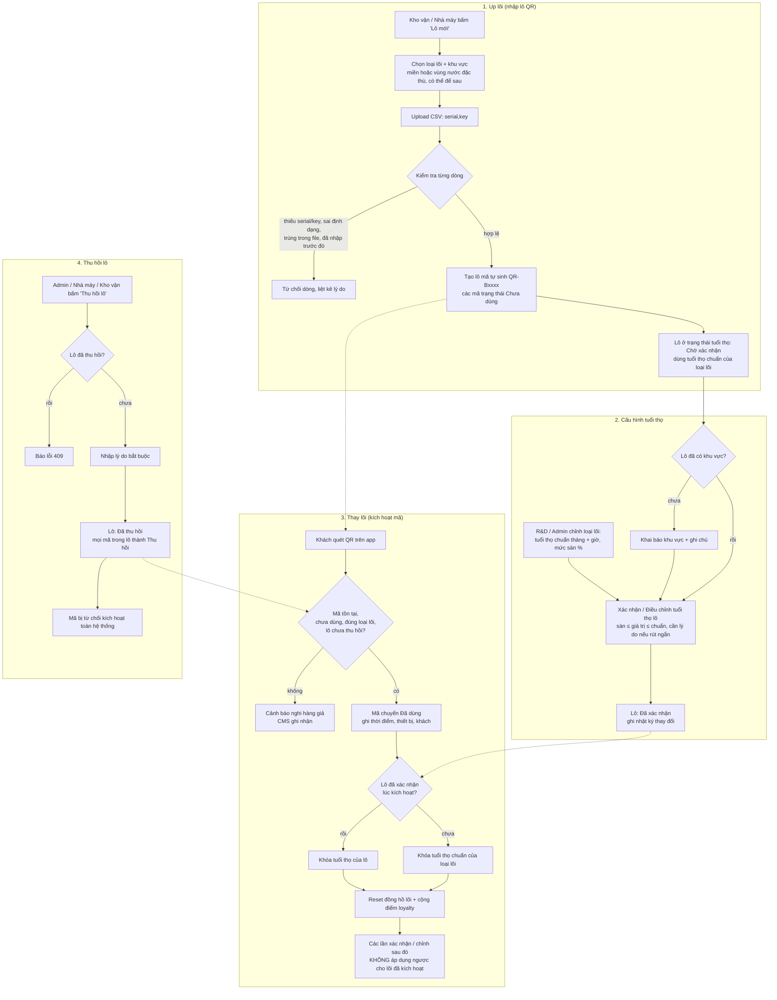

# Luồng QR lõi lọc: up lõi, cấu hình tuổi thọ, thay lõi, thu hồi

Sơ đồ theo logic code hiện tại (spec §9 trong `CMS_QnA_V1_SPEC.md`). Phần thay lõi
(quét QR) chạy ở app OneKangaroo và backend; CMS chỉ giữ dữ liệu và trạng thái.

## Điểm cần lưu ý

- **Thu hồi:** đổi trạng thái cả lô trong mock, kể cả các mã đã dùng. Chỉ chặn các
  lần kích hoạt tiếp theo, không hoàn lại lõi đã kích hoạt.
- **Lô đã thu hồi:** không khai báo khu vực hay chỉnh tuổi thọ được nữa
  (`batchAlreadyRecalled`).
- **Vô hiệu hóa:** spec §9.6 có vô hiệu hóa từng mã hoặc lô; code hiện chỉ thu hồi
  theo lô.
