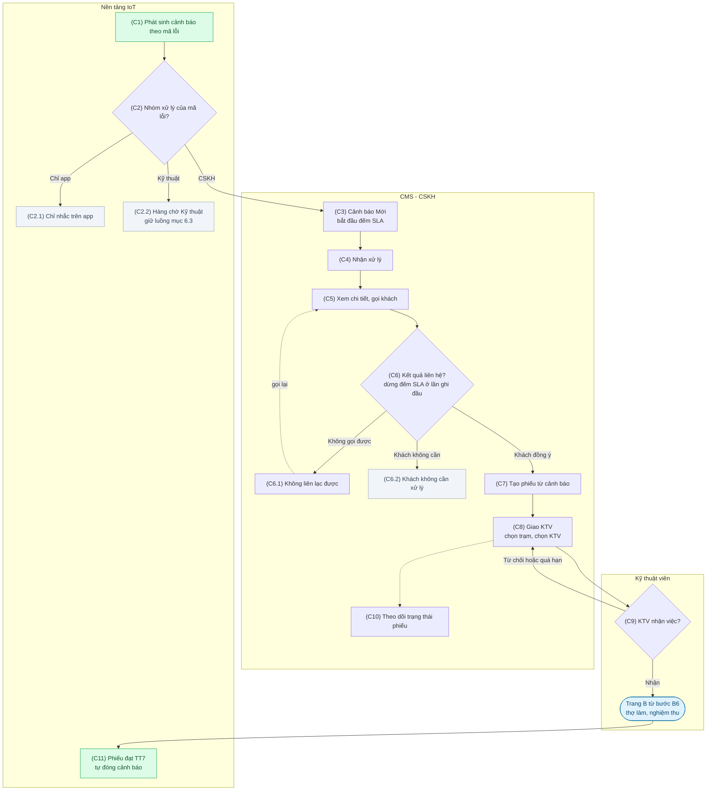
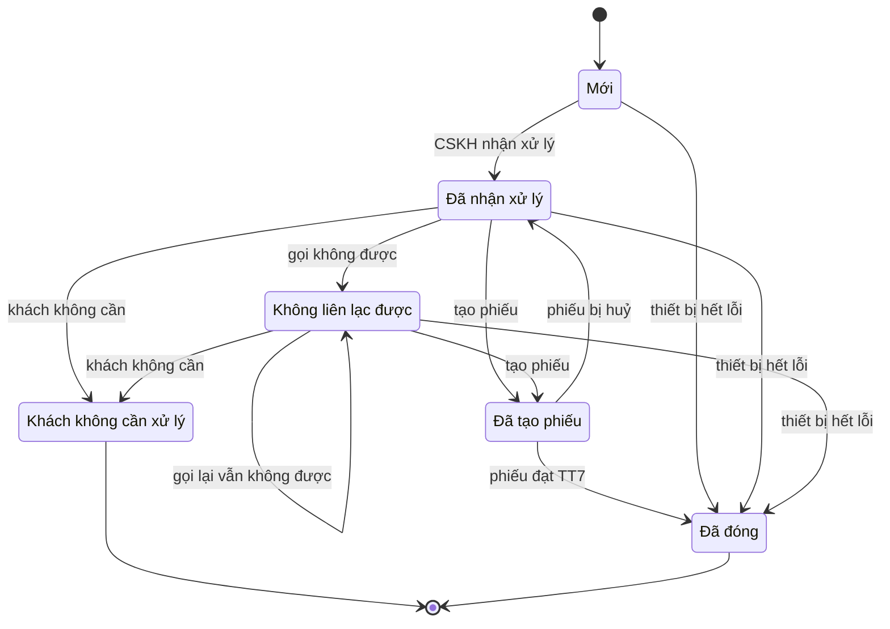

# Trung tâm cảnh báo — luồng CSKH nhận, liên hệ khách, tạo phiếu, giao KTV

Ngày: 2026-11-10
Nguồn: `docs/CMS_QnA_V1_SPEC.md` mục 6 và 2.4; sơ đồ
`Quy_trinh_trien_khai_dich_vu_qua_app_KGR.drawio.pdf` trang A và trang B; trao
đổi với chủ sản phẩm ngày 2026-11-10.

Trạng thái: bản đề xuất. Các mục đánh dấu **(đề xuất)** là lựa chọn của người
soạn, chưa được KGR xác nhận. Các mục không đánh dấu là điều chủ sản phẩm đã
chốt hoặc đã có trong spec.

Thuật ngữ dùng trong tài liệu:

- **CSKH**: nhân viên chăm sóc khách hàng, làm việc trên CMS.
- **KTV**: kỹ thuật viên đến nhà khách.
- **Phiếu**: phiếu dịch vụ, đi qua các trạng thái TT1–TT9 của trang B.
- **SLA**: thời hạn phải xử lý xong một bước, tính theo mức độ cảnh báo.

## 1. Mục đích

Hiện nay spec mục 6.3 mô tả cảnh báo được gán thẳng cho KTV. Nghiệp vụ thực tế
khác: CSKH là người nhận cảnh báo, gọi cho khách, và chỉ khi khách cần thợ đến
mới tạo phiếu rồi giao cho KTV. Sơ đồ quy trình dịch vụ (trang A, B) chỉ vẽ
trường hợp khách tự đặt trên app, chưa có nhánh bắt đầu từ cảnh báo.

Tài liệu này định nghĩa nhánh còn thiếu đó, gọi là **Trang C**, nối từ cảnh báo
vào trang B.

## 2. Phạm vi

Trong phạm vi:

- Màn danh sách cảnh báo và chi tiết cảnh báo cho CSKH.
- Ghi kết quả liên hệ khách.
- Tạo phiếu dịch vụ từ cảnh báo và giao KTV.
- Hiển thị trạng thái phiếu trên cảnh báo; cảnh báo tự đóng khi KTV hoàn thành.

Ngoài phạm vi lần này:

- Màn danh sách phiếu, chi tiết phiếu và các bước sau khi giao KTV (thợ làm,
  nghiệm thu, thanh toán, đánh giá). Cảnh báo chỉ đọc trạng thái của phiếu.
- Màn làm việc của KTV.
- Tạm tính giá và thanh toán khi CSKH tạo phiếu.
- Tính khung giờ trống theo trạm và tồn vật tư (bước A4 của trang A).
- Màn cấu hình SLA, escalation và kênh thông báo (mục 6.4, 6.5). Giá trị SLA
  đọc từ cấu hình hệ thống đã có.
- Màn cấu hình bảng "mã lỗi → nhóm xử lý". Lần này dữ liệu do backend trả về.
- Gửi push, SMS, Zalo cho khách từ cảnh báo.
- Giới hạn dữ liệu theo khu vực được gán cho từng nhân viên.

Điều phải tránh, kể cả khi màn hình chạy đúng:

- CSKH gọi cho khách về việc app đã nhắc và khách đang tự xử lý.
- Cảnh báo bị đóng trong khi lỗi chưa được xử lý.
- Thông tin khách hàng lộ ra cho vai trò không có quyền xem.
- SLA luôn đỏ vì đếm cả thời gian chờ lịch hẹn của khách.

## 3. Luồng Trang C

### Diễn giải từng bước

**(C1) Phát sinh cảnh báo.** Nền tảng IoT tạo cảnh báo theo bảng mã lỗi dùng
chung. Hai quy tắc chống trùng **(đề xuất)**:

- Máy đang có một cảnh báo chưa kết thúc cho cùng mã lỗi: không tạo cảnh báo
  mới, chỉ tăng số lần ghi nhận và cập nhật thời điểm gần nhất.
- Cảnh báo trước đó cho cùng máy và cùng mã lỗi đã kết thúc: chỉ tạo cảnh báo
  mới khi lỗi đã hết rồi xuất hiện lại. Lỗi kéo dài liên tục không sinh thêm
  cảnh báo.

**(C2) Phân nhóm xử lý.** Mỗi mã lỗi thuộc đúng một nhóm. Bảng phân nhóm do
backend giữ và phải sửa được qua cấu hình, không viết cứng trong giao diện.
Phân nhóm mặc định **(đề xuất)**:

| Nhóm xử lý | Mã lỗi thuộc nhóm                                                                                             | Đi đâu                                                          |
| ---------- | ------------------------------------------------------------------------------------------------------------- | --------------------------------------------------------------- |
| Chỉ app    | Lõi chạm ngưỡng cảnh báo mức 1 (`ER00056`–`ER00060`)                                                          | App nhắc khách (Luồng 2 của sơ đồ). Không xuất hiện trên CMS.   |
| CSKH       | Lõi chạm ngưỡng mức 2 (`ER00061`–`ER00065`); lỗi tại máy của một khách cần thợ hoặc cần hướng dẫn (rò, áp, bơm, cảm biến) | Hàng chờ CSKH, đi tiếp C3.                                      |
| Kỹ thuật   | Lỗi diện rộng hoặc thuần kỹ thuật (mất kết nối hàng loạt, lỗi sau OTA)                                        | Giữ nguyên luồng mục 6.3: Mới → Đã nhận xử lý → Đóng kèm kết quả. |

Việc tách mức 1 và mức 2 của lõi là để CSKH không gọi trùng với lời nhắc của
app.

Luồng nhóm Kỹ thuật là luồng mục 6.3 bỏ phần "gán KTV": người nhận xử lý là
nhân viên trên CMS, không phải KTV đến nhà.

Máy chưa gắn với khách hàng nào thì không có ai để gọi. Cảnh báo của máy đó,
dù mã lỗi thuộc nhóm CSKH, được xếp vào nhóm Kỹ thuật **(đề xuất)**.

**(C3) Vào hàng chờ CSKH.** Cảnh báo ở trạng thái Mới. SLA phản hồi bắt đầu đếm
từ thời điểm phát sinh (xem mục 5).

**(C4) Nhận xử lý.** Một nhân viên CSKH bấm "Nhận xử lý". Cảnh báo chuyển sang
Đã nhận xử lý và ghi tên người nhận. Mỗi cảnh báo chỉ có một người xử lý tại một
thời điểm, và chỉ người đó thao tác tiếp được trên cảnh báo.

Để cảnh báo không bị kẹt khi người xử lý nghỉ ca, bất kỳ người nào có quyền xử
lý cảnh báo cũng bấm được "Chuyển cho tôi" để trở thành người xử lý mới. Thao
tác này được ghi vào lịch sử **(đề xuất)**.

**(C5) Xem chi tiết và gọi khách.** Màn chi tiết cho CSKH đủ thông tin để gọi:
cảnh báo (tên, mã lỗi, mức độ, thời điểm, số lần ghi nhận), thiết bị (serial,
model, tình trạng lõi, trạng thái kết nối, tình trạng bảo hành), khách hàng
(tên, số điện thoại, địa chỉ lắp đặt) và lịch sử thao tác. Cuộc gọi diễn ra
ngoài hệ thống; CMS không gọi điện.

**(C6) Ghi kết quả liên hệ.** Bắt buộc chọn một trong ba kết quả:

- **(C6.1) Không liên lạc được.** Cảnh báo chuyển sang trạng thái Không liên lạc
  được và vẫn nằm trong hàng chờ. CSKH gọi lại sau và ghi kết quả mới. Hệ thống
  đếm số lần gọi. Không giới hạn số lần và không tự đóng **(đề xuất)**.
- **(C6.2) Khách không cần xử lý.** Bắt buộc chọn lý do từ danh mục và có thể
  ghi chú thêm. Cảnh báo kết thúc ở trạng thái Khách không cần xử lý. Danh mục
  lý do **(đề xuất)**: đã hướng dẫn khách tự xử lý; khách đã tự xử lý; khách từ
  chối dịch vụ; máy hoạt động bình thường; lý do khác (bắt buộc ghi chú).
- **Khách đồng ý cho thợ đến.** Đi tiếp C7.

**(C7) Tạo phiếu từ cảnh báo.** CSKH điền form tạo phiếu ngay trên cảnh báo.
Hệ thống điền sẵn những gì đã biết:

| Trường                    | Giá trị điền sẵn                                         | CSKH sửa được |
| ------------------------- | -------------------------------------------------------- | ------------- |
| Nguồn phiếu               | "Cảnh báo" kèm mã cảnh báo                               | Không         |
| Khách hàng, thiết bị      | Từ cảnh báo                                              | Không         |
| Tình trạng bảo hành       | Còn hạn hoặc hết hạn, để CSKH báo trước cho khách        | Không         |
| Loại dịch vụ              | Theo mã lỗi: lỗi lõi → Thay lõi; lỗi khác → Sửa chữa     | Có            |
| Lõi cần thay (Thay lõi)   | Các lõi đã vượt ngưỡng được tích sẵn                     | Có            |
| Mô tả lỗi (loại khác)     | Tên cảnh báo                                             | Có            |
| Người liên hệ, SĐT        | Chủ thiết bị                                             | Có            |
| Địa chỉ                   | Địa chỉ lắp đặt                                          | Có            |
| Lịch hẹn                  | Trống; chọn ngày và khung 2 giờ đã thống nhất với khách  | Có            |
| Ghi chú cho KTV           | Trống                                                    | Có            |

Loại dịch vụ chọn được: Thay lõi, Sửa chữa, Vệ sinh & kiểm tra **(đề xuất)**.
Phiếu tạo từ cảnh báo bỏ qua cuộc gọi xác nhận ở bước B1–B3 vì CSKH vừa gọi
xong. Phiếu ghi hình thức "trả khi xong", không có tạm tính **(đề xuất)**.

Khi tạo phiếu thành công: cảnh báo chuyển sang Đã tạo phiếu và phiếu ở TT1. Nếu
đây là lần ghi kết quả liên hệ đầu tiên thì SLA phản hồi dừng đếm (mục 5). Một
cảnh báo chỉ gắn với một phiếu đang mở. Nếu máy đang có phiếu khác chưa đóng,
form hiện cảnh báo để CSKH biết nhưng vẫn cho tạo **(đề xuất)**.

**Gộp cảnh báo cùng máy.** Một máy có thể có nhiều cảnh báo nhóm CSKH cùng mở,
ví dụ hai lõi cùng vượt ngưỡng mức 2. Form tạo phiếu liệt kê các cảnh báo nhóm
CSKH khác đang mở của máy đó và tích sẵn tất cả; CSKH bỏ tích được. Các cảnh báo
được tích gắn vào cùng phiếu: chuyển sang Đã tạo phiếu, ghi cùng kết quả liên
hệ, và đóng cùng lúc khi phiếu đạt TT7. Một phiếu vì vậy gắn được với nhiều
cảnh báo. Chủ sản phẩm đã chốt cách gộp này.

**(C8) Giao KTV.** Là bước thứ hai của cùng form. Hệ thống chọn sẵn trạm phụ
trách địa chỉ và liệt kê KTV theo thứ tự của bước B4: rảnh trong khung giờ hẹn,
đúng chuyên môn, điểm đánh giá. Mỗi dòng hiện tên, chuyên môn, có rảnh trong
khung giờ hay không, số phiếu trong ngày và điểm đánh giá. CSKH chọn một KTV;
phiếu chuyển TT2. CSKH cũng có thể lưu phiếu và giao sau; khi đó cảnh báo hiện
"Chờ giao KTV" và có nút "Giao KTV".

**(C9) KTV nhận việc.** Theo bước B5, KTV có 30 phút để nhận. Nếu KTV từ chối
hoặc quá hạn, cảnh báo hiện "Cần giao lại KTV" và CSKH giao cho người khác, bắt
buộc ghi lý do. Trong lúc đó phiếu vẫn ở TT2 và chưa có KTV nhận. Sau khi KTV đã
nhận việc (TT3), việc đổi KTV thuộc màn xử lý phiếu, ngoài phạm vi lần này.

**(C10) Theo dõi.** Trên danh sách và chi tiết cảnh báo, CSKH thấy mã phiếu,
KTV, lịch hẹn và trạng thái hiện tại của phiếu. Chỉ đọc.

**(C11) Tự đóng.** Khi phiếu đạt TT7 (khách ký nghiệm thu), cảnh báo tự chuyển
sang Đã đóng với kết quả "Đã xử lý theo phiếu". Chọn TT7 làm mốc "KTV hoàn
thành" là **(đề xuất)**; thanh toán và đánh giá không giữ cảnh báo mở.

Hai trường hợp ngoài đường chính:

- **Phiếu bị huỷ**: cảnh báo quay về Đã nhận xử lý để CSKH liên hệ lại, vì lỗi
  có thể còn **(đề xuất)**. Theo trang A và B, phiếu có thể bị huỷ ở bất kỳ
  trạng thái nào trước TT7: khách tự huỷ trên app trước khi KTV bấm Bắt đầu đi
  (TT5), hoặc khách từ chối báo giá phát sinh tại nhà (B15.1). Lần này CMS
  không có nút huỷ phiếu; việc huỷ đến từ app hoặc từ màn xử lý phiếu sau này.
- **Thiết bị tự hết lỗi**: nếu cấu hình "tự đóng cảnh báo" đang bật (mục 6.3)
  và cảnh báo chưa có phiếu, cảnh báo tự chuyển Đã đóng với kết quả "Thiết bị
  hết lỗi". Cảnh báo đã có phiếu thì không tự đóng theo cách này mà đi theo
  phiếu **(đề xuất)**.

## 4. Trạng thái cảnh báo nhóm CSKH

"Khách không cần xử lý" và "Đã đóng" là hai trạng thái kết thúc. Quy tắc tạo lại
cảnh báo sau khi kết thúc nằm ở bước C1.

Thao tác "Chuyển cho tôi" (bước C4) đổi người xử lý nhưng không đổi trạng thái.

Mức độ dùng ba giá trị đã có trong cấu hình hệ thống: Nghiêm trọng, Trung bình,
Thấp.

### Trạng thái phiếu hiển thị trên cảnh báo

Sơ đồ trang B có 9 trạng thái, spec mục 2.4 có 5. Cảnh báo hiển thị tên trạng
thái chi tiết của trang B. Bảng quy đổi sang 5 trạng thái của mục 2.4
**(đề xuất)**:

| Trang B                                     | Mục 2.4       |
| ------------------------------------------- | ------------- |
| TT1 Đã đặt                                  | Chờ xác nhận  |
| TT2 Điều phối, TT3 Nhận việc                | Đã phân công  |
| TT4 Xuất vật tư, TT5 Bắt đầu đi, TT6 Check-in | Đang xử lý    |
| TT7 Nghiệm thu, TT8 Thanh toán, TT9 Đánh giá | Hoàn thành    |
| Huỷ                                         | Hủy           |

## 5. SLA

Cảnh báo nhóm CSKH có một đồng hồ **(đề xuất)**:

- **Bắt đầu**: thời điểm cảnh báo phát sinh.
- **Dừng**: lần đầu tiên CSKH ghi kết quả liên hệ, tức là tạo phiếu, ghi "Khách
  không cần xử lý" hoặc ghi "Không liên lạc được".
- **Thời hạn**: lấy theo mức độ từ tham số "SLA theo mức độ" trong cấu hình hệ
  thống. Mức độ không cấu hình thời hạn thì cảnh báo không có SLA.
- **Cách tính**: theo giờ đồng hồ, không trừ giờ nghỉ.

Sau khi đồng hồ dừng, cột SLA hiển thị "Đạt" hoặc "Trễ" kèm thời gian đã dùng.
Các mốc thời gian sau khi có phiếu (KTV nhận việc trong 30 phút, v.v.) thuộc về
phiếu theo trang B, không tính vào SLA cảnh báo.

Hiển thị trong khi còn đếm: đếm ngược theo thời gian thực; đổi màu khi sắp hết
và khi quá hạn (mục 6.4). Backend trả về thời điểm hết hạn và thời điểm bắt đầu
cảnh báo "sắp hết"; giao diện chỉ so với giờ hiện tại, không tự đặt ngưỡng.

Quá hạn: cảnh báo được đánh dấu "Quá SLA" và lọc được trên danh sách. Việc gửi
thông báo cho cấp quản lý nằm ngoài phạm vi lần này.

Cảnh báo nhóm Kỹ thuật giữ cách đếm của spec hiện tại: đến khi đóng.

## 6. Màn hình

**Danh sách cảnh báo** (`/alerts`, thay bản demo hiện có):

- Thẻ tổng: số cảnh báo đang mở và số nghiêm trọng đang mở (mục 6.1); thêm số
  quá SLA và số đang chờ tôi xử lý **(đề xuất)**.
- Bộ lọc, lưu trên URL: mức độ, trạng thái, tùy chọn "Hiện cả đã xử lý", khu
  vực, model, khoảng thời gian (mục 6.2); thêm nhóm xử lý, "Của tôi", quá SLA
  và ô tìm theo serial hoặc mã lỗi **(đề xuất)**.
- Cột: tên cảnh báo, mức độ, mã lỗi, serial, model, khu vực, thời gian, SLA còn
  lại, người xử lý (mục 6.1); thêm trạng thái và phiếu (mã, trạng thái).
- Thao tác trên dòng: "Nhận xử lý" khi cảnh báo còn Mới. Bấm vào dòng mở chi
  tiết.
- Nút "Xuất báo cáo" (mục 6.2).

**Chi tiết cảnh báo**: các khối thông tin của bước C5, khối phiếu dịch vụ (khi
đã có), danh sách cảnh báo khác đang mở của cùng máy, lịch sử thao tác, và các
nút theo trạng thái: Nhận xử lý, Chuyển cho tôi, Ghi kết quả liên hệ, Tạo phiếu,
Giao KTV, Giao lại KTV. Với cảnh báo nhóm Kỹ thuật chỉ có Nhận xử lý, Chuyển cho
tôi và Đóng (bắt buộc ghi kết quả, mục 6.3).

**Hộp thoại Ghi kết quả liên hệ**: ba lựa chọn của bước C6. Chọn "Khách đồng ý"
thì mở form tạo phiếu; kết quả liên hệ chỉ được ghi khi phiếu tạo thành công.
Lựa chọn "Khách đồng ý" chỉ hiện với người có cả quyền xử lý cảnh báo và quyền
tạo phiếu (mục 7).

**Form Tạo phiếu và giao KTV**: hai bước C7 và C8.

Trình bày cụ thể (trang riêng hay ngăn kéo, bố cục các khối) do người dựng
quyết định theo `docs/SCREEN_WORKFLOW.md` và các thành phần dùng chung đã có.

## 7. Quyền và dữ liệu cá nhân

Không thêm capability mới **(đề xuất)**; dùng lại các quyền đã có:

| Việc                                             | Capability        | Vai trò đang có                        |
| ------------------------------------------------ | ----------------- | -------------------------------------- |
| Xem danh sách, chi tiết cảnh báo                 | `alerts.read`     | Super Admin, Admin, Nhà máy, TT DV, KD |
| Xuất báo cáo                                     | `alerts.export`   | Super Admin, Admin, Nhà máy, TT DV     |
| Nhận xử lý, chuyển cho tôi, ghi kết quả liên hệ, đóng | `alerts.handle` | Super Admin, Admin, TT DV |
| Tạo phiếu từ cảnh báo | `alerts.handle` và `service.write` | Super Admin, Admin, TT DV |
| Giao và giao lại KTV | `service.write` | Super Admin, Admin, TT DV |
| Xem tên, SĐT, địa chỉ khách trong cảnh báo | `device.pii.full` | Super Admin, Admin, TT DV |

Thông tin phiếu hiển thị trên cảnh báo theo quyền đang có (chủ sản phẩm đã
chốt):

| Thông tin phiếu | Capability | Vai trò đang có |
| --- | --- | --- |
| Mã phiếu, trạng thái phiếu | `alerts.read` | Super Admin, Admin, Nhà máy, TT DV, KD |
| KTV, lịch hẹn | `service.read` | Super Admin, Admin, TT DV, KD |
| Người liên hệ, SĐT, địa chỉ | `device.pii.full` | Super Admin, Admin, TT DV |
| Ghi chú cho KTV | `service.write` | Super Admin, Admin, TT DV |

Kho vận có `service.read` nhưng không có `alerts.read` nên không vào được màn
này.

- Thiếu quyền thì ẩn nút, không chỉ làm mờ.
- Vai trò không có `device.pii.full` (Nhà máy, KD) vẫn xem được phần kỹ thuật
  của cảnh báo nhưng không thấy khối khách hàng, và không thấy nội dung ghi chú
  của CSKH trong lịch sử thao tác vì ghi chú có thể chứa thông tin khách
  **(đề xuất)**. Việc che phải làm ở phía API, giao diện không tự che.
- File xuất chỉ chứa các cột của danh sách, gồm mã và trạng thái phiếu, không có
  thông tin khách, KTV hay lịch hẹn.
- CSKH và điều phối được coi là cùng vai trò TT DV, đúng như ma trận quyền hiện
  tại **(đề xuất)**.

Mỗi thao tác (nhận xử lý, chuyển cho tôi, ghi kết quả liên hệ, tạo phiếu, giao
KTV, giao lại KTV, đóng) ghi một dòng lịch sử gồm người thực hiện, thời điểm,
giá trị trước và sau, lý do hoặc ghi chú. Lịch sử không sửa, không xoá được từ
giao diện.

## 8. Ràng buộc kỹ thuật

- Dựng thành một slice đầy đủ theo `docs/SCREEN_WORKFLOW.md`, thay bản demo
  `src/features/alerts` đang giữ dữ liệu trong bộ nhớ.
- API là hợp đồng mới, chưa có trong spec, cần backend thống nhất. Tối thiểu
  cần: danh sách và số đếm cảnh báo; chi tiết cảnh báo kèm lịch sử và phiếu;
  nhận xử lý; ghi kết quả liên hệ; đóng (nhóm Kỹ thuật); tạo phiếu từ cảnh báo;
  gợi ý trạm và KTV theo địa chỉ, khung giờ, loại dịch vụ; giao và giao lại KTV.
  Tên đường dẫn và hình dạng dữ liệu do người dựng đề xuất.
- Chuyên môn KTV: trang B chỉ nêu ví dụ "lắp đặt, sửa bo mạch". Lần này dùng
  quy tắc đơn giản **(đề xuất)**: Thay lõi và Vệ sinh & kiểm tra thì KTV nào
  cũng làm được; Sửa chữa cần KTV có chuyên môn sửa chữa.
- Dữ liệu giả lập (MSW) phải có trạm, KTV, và cách thử được các tình huống: KTV
  nhận việc, KTV từ chối hoặc quá hạn, phiếu đạt TT7 làm cảnh báo tự đóng,
  phiếu bị huỷ, cảnh báo quá SLA, danh sách rỗng, lỗi tải. Vì chưa có màn cho
  KTV, bản giả lập tự chuyển trạng thái phiếu.
- Chi tiết thiết bị đang có nút tạo phiếu từ cảnh báo lõi
  (`POST /devices/:id/service-tickets`). Lần này giữ nguyên nút đó. API phiếu
  mới nên thiết kế sao cho sau này nút đó chuyển sang dùng chung được.
- Tab "Lịch dịch vụ" ở màn Khách hàng là bản demo riêng và không đổi lần này;
  phiếu tạo từ cảnh báo chưa hiện ở đó.

## 9. Việc cần làm sau khi duyệt

Cập nhật `docs/CMS_QnA_V1_SPEC.md`: mục 6.1 (người xử lý là CSKH), mục 6.3
(trạng thái và luồng theo nhóm xử lý), mục 6.4 (mốc dừng SLA), mục 2.4 (quy đổi
trạng thái phiếu).

## 10. Câu hỏi cần KGR xác nhận

Mỗi câu kèm giá trị tài liệu này đang dùng tạm.

1. Bảng phân nhóm xử lý và mức độ cho toàn bộ mã lỗi `ER00051`–`ER00074`. Đang
   dùng: bảng ở bước C2.
2. Lõi mức 1 chỉ để app nhắc, mức 2 mới chuyển CSKH. Đang dùng: đúng như vậy.
3. "KTV hoàn thành" là mốc nào của phiếu. Đang dùng: TT7 ký nghiệm thu.
4. Gọi không được bao nhiêu lần thì dừng, có tự đóng không. Đang dùng: không
   giới hạn, không tự đóng.
5. CSKH tạo phiếu có cần tạm tính và chọn hình thức thanh toán không. Đang
   dùng: không, phiếu ghi "trả khi xong".
6. CSKH và điều phối có phải hai vai trò riêng trên CMS không. Đang dùng: cùng
   vai trò TT DV.
7. Quá SLA thì báo cho ai. Đang dùng: chỉ đánh dấu trên danh sách.
8. SLA tính theo giờ đồng hồ hay giờ làm việc. Đang dùng: giờ đồng hồ.
9. Khách tự đặt dịch vụ trên app cho cùng lỗi thì cảnh báo có tự gắn với phiếu
   đó không. Đang dùng: không tự gắn; form tạo phiếu chỉ cảnh báo máy đang có
   phiếu mở.
10. Sau khi khách không cần xử lý, bao lâu thì được tạo lại cảnh báo cho cùng
    lỗi. Đang dùng: chỉ khi lỗi hết rồi xuất hiện lại.
